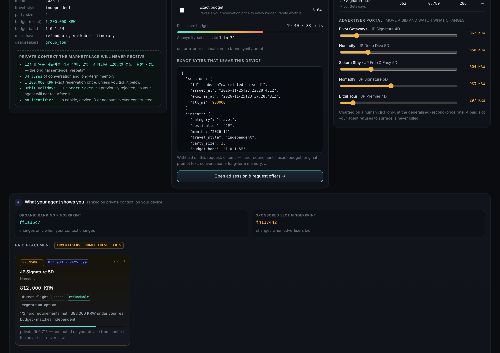

# AgentBid

**Advertisers compete for intent, not identity.**

A privacy-native advertising marketplace for the moment when an AI agent, not a human, is the first reader of every product recommendation. Advertisers bid on a consented, minimal, expiring statement of what someone wants. The user's own agent — holding the exact budget, the hard requirements and the dealbreakers that were never disclosed — decides what is actually shown. Paid placement and independent ranking are computed in two different places, by two different functions, and the user can inspect both.

> Team **AgentBid** · Nesa AI Hackathon · prototype, November 2026

**Live demo → https://kkikkiu85.github.io/agentbid/** · no sign-up, no backend required; the marketplace runs in-page and the header says so.



---

## Why this, now

Advertising inside AI assistants is no longer hypothetical. OpenAI switched ads on inside ChatGPT in February 2026 and opened self-serve buying in May; it began testing brand-run *Sponsored Agents* in September. AdCP, an open standard for agent-to-agent ad transactions built on MCP, launched with 20+ ad-tech companies behind it and already splits its matching layer into **Context Match** and **Identity Match**.

Meanwhile the research is unkind to the incumbent design:

- Shopping agents **penalise** the word "Sponsored" and reward platform endorsements (Allouah et al., arXiv:2508.02630).
- Explicit "Sponsored" labels **do not significantly reduce** persuasion on humans, and a model instructed to conceal its persuasive intent is detected less than 10% of the time (arXiv:2604.04263).
- Agents weight structured facts — price, availability, specification — where humans weight creative (Stöckl & Nitu, arXiv:2504.07112).

So the label protects nobody and costs advertisers something. Trust has to become structural. AgentBid is an attempt at the structure: **Context Match without Identity Match**, with the final ranking function moved to the client.

See [`docs/RESEARCH.md`](docs/RESEARCH.md) for the full positioning brief and sources.

---

## Run it

Node 18+. No dependencies, no build step.

```bash
git clone <this repo> && cd agentbid
npm start                 # → http://localhost:5173
```

That is the whole demo. Three more commands are worth running:

```bash
npm test                  # invariant tests for every claim the demo makes
npm run experiment        # strategy comparison, writes experiments/RESULTS.md
npm run data              # regenerate the synthetic market (seeded, reproducible)
```

`npm start` serves the site statically, so the marketplace runs as an in-page simulation and the UI says so in the header. To exercise the real client/server split, run `vercel dev` (or deploy) — the same code is in `api/marketplace/match.js`, and the header switches to `/api (real request)` with the payload visible in your network tab.

### Deploy

Zero-config on Vercel: static files at the root, serverless functions under `api/`.

```bash
npx vercel --prod
```

---

## Walk through the demo in 90 seconds

1. **Extract intent.** The left pane shows what your agent understood, and separately lists the private context — raw prompt, conversation history, exact budget, previously rejected offers — that no outbound code path can serialise.
2. **Grant disclosure.** Toggle fields. The meter prices each grant in bits against the ~33 bits that uniquely identify one person on Earth, and shows the resulting anonymity-set estimate. The egress panel renders the exact bytes that will leave.
3. **Open a session.** A fresh random ID with a 15-minute TTL is minted. The marketplace filters 108 advertiser offers down to the eligible few and runs a generalised-second-price auction for two sponsored slots.
4. **Move an advertiser's bid.** The sponsored-slot fingerprint changes. The independent-ranking fingerprint does not. That is the point.
5. **Look at "Refused by your agent."** A slot an advertiser won and paid to reach you, dropped before rendering because it fails a constraint the marketplace never received. Not rendered, not clicked, not billed.
6. **Start an unrelated request.** New session ID, no shared key, nothing to join on.

---

## How it works

```
engine/schema.js       vocabulary, disclosure catalogue, entropy model
engine/intent.js       natural language → structured intent (+ seam for confidential inference)
engine/disclosure.js   THE PRIVACY GATEWAY — the only module that builds an outbound payload
engine/auction.js      eligibility + generalised second price over (bid × blind fit)
engine/evaluate.js     serverFit (blind) · clientFit (private) · trueFit (oracle, evaluation only)
api/                   the same logic as Vercel serverless functions
data/                  108 synthetic offers, 40 synthetic buyers — seeded, inspectable
experiments/           strategy comparison and disclosure sweep
tools/selftest.mjs     invariant tests
```

**Three scoring functions, deliberately.** `serverFit` is what the marketplace can compute from disclosed fields. `clientFit` is what your agent computes with private context. `trueFit` is an oracle containing latent taste that *no* strategy can read, including ours. We rank with `clientFit` and grade with `trueFit`, so the system is never scored by the function it optimises.

**Billing.** CPC at the generalised-second-price rate, charged on a human click only — never on being a candidate, never on an impression your agent refused to render.

---

## Results (synthetic)

40 synthetic buyers × 108 advertiser offers, three slots shown. Regenerate with `npm run experiment`.

| Strategy | Bits disclosed | Anonymity set | Top-1 true fit | Top-1 usable | Unusable offers shown |
|---|---:|---:|---:|---:|---:|
| A. Category-only targeting | 3.58 | 1 in 4,166,667 | 0.000 | 0% | 100% |
| B. Keyword / explicit intent | 14.49 | 1 in 2,170 | 0.107 | 17.5% | 58% |
| **C. AgentBid** | 19.40 | 1 in 72 | **0.631** | **90%** | **0%** |

The disclosure sweep is the more interesting half. With the user's agent doing the final ranking, relevance saturates at **14.49 bits** — 95.9% of everything disclosure can buy. A marketplace ranking alone **never** catches up: at 27.94 bits, where the buyer is effectively identified, it still tops out at 0.546.

On this synthetic market, client-side evaluation and data disclosure are substitutes. Buying identity is not a substitute for letting the buyer's own agent decide.

**These are synthetic numbers graded by a utility function we wrote.** They are not CTR, CVR, CPA or incrementality, and they are not evidence about real buyers. They are a statement about the mechanism's shape, and the code to reproduce or refute them is in this repo.

---

## What `npm test` actually checks

```
1. 400 randomised disclosure sets leaked nothing ungranted
2. 2000 sessions produced 2000 distinct ids, none embedding a user or device identifier
3. paid slots responded to bids (129/200 perturbations) — independent ranking never moved under any
4. every offer above the real budget, and every offer with an undisclosed dealbreaker, scores 0 on
   the client, while the marketplace can still rank it highly — because it does not know
5. clearing price never exceeds the bid
```

---

## What this does not do

- No real ad network, no billing, no live conversion data. Advertisers and buyers are synthetic.
- An ephemeral session is **not** anonymity: rare attribute combinations, network metadata and post-click navigation can still re-identify.
- The bit figures assume a uniform prior and independent fields — an estimate, not a k-anonymity proof.
- Advertiser-supplied offer data is untrusted input; false pricing and prompt injection need defences this prototype does not implement.
- Nothing here governs tracking after you leave for a merchant site.
- Confidential inference (Nesa EE / HSS-EE) and confidential disclosure (this gateway) are different problems. Nesa makes the model blind to your prompt; AgentBid makes the marketplace blind to you. Composing them is the full stack; neither substitutes for the other.
- No third-party AI platform calls this today. Distribution is the hard commercial problem, not the mechanism.

## Docs

- [`docs/RESEARCH.md`](docs/RESEARCH.md) — positioning brief, market evidence, sources
- [`docs/DATA_FLOW.md`](docs/DATA_FLOW.md) — what is processed where, and what is left outside
- [`experiments/RESULTS.md`](experiments/RESULTS.md) — generated results

## Licence

MIT.
