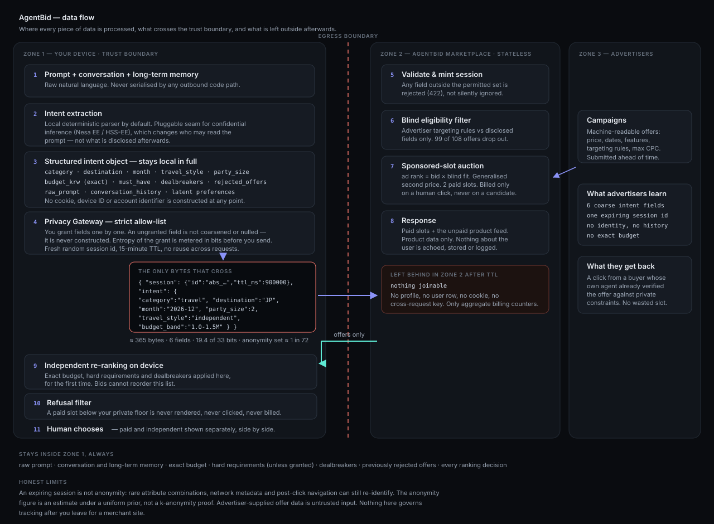

# Data flow — what is processed where, and what is left outside



One request, eleven steps, one boundary crossing in each direction.

## Zone 1 — your device (trust boundary)

| Step | What happens | What it touches |
|---|---|---|
| 1 | Prompt, conversation and long-term memory are held locally | raw text, never serialised by any outbound code path |
| 2 | Intent extraction. A deterministic parser by default; `extractWithModel()` is the seam for confidential inference (Nesa EE / HSS-EE) or a local LLM | raw text → structured object |
| 3 | The full structured intent exists only here: exact budget, hard requirements, dealbreakers, previously rejected offers, latent preferences. **No cookie, device ID or account identifier is constructed at any point** | full intent |
| 4 | **Privacy Gateway.** You grant fields individually. The grant is metered in bits before you send. A fresh random session ID with a 15-minute TTL is minted per request | allow-list → egress payload |
| 9 | The returned offers are re-ranked here, using the exact budget, hard requirements and dealbreakers — applied for the first time in the whole pipeline. Bids are not an input to this function | offers + full intent |
| 10 | Refusal filter: a paid slot scoring below your private floor is never rendered, so it is never clicked and never billed | — |
| 11 | You choose. Paid and independent results are shown as separate, labelled lists | — |

`engine/disclosure.js` is the only module that constructs an outbound payload. There is no code path in the project that serialises `intent.private`, and `npm test` fuzzes 400 random disclosure sets to confirm it.

## The boundary

Outbound, and nothing else:

```json
{ "session": { "id": "abs_f48nk4kiqhmqxamzid", "issued_at": "…", "expires_at": "…", "ttl_ms": 900000 },
  "intent":  { "category": "travel", "destination": "JP", "month": "2026-12",
               "travel_style": "independent", "party_size": 2, "budget_band": "1.0-1.5M" },
  "protocol": { "name": "agentbid-intent", "version": "0.3", "adcp_profile": "context-match-only" } }
```

About 365 bytes. Six fields. 19.4 of the ~33 bits that would identify a single person on Earth; an anonymity-set estimate of roughly 1 in 72 against a 50-million population, **under a uniform prior** — an estimate, not a k-anonymity proof.

Inbound: product data only. No user attribute is echoed back, because none was stored.

## Zone 2 — the marketplace

Stateless by design. It validates the payload against a permitted-field list and returns **422** on anything unexpected rather than ignoring it. It filters advertiser targeting rules against the disclosed fields, runs a generalised-second-price auction for two sponsored slots on `bid × blind fit`, and returns the winners plus the unpaid product feed.

After the TTL there is nothing joinable left: no profile, no user row, no cookie, no cross-request key — only aggregate billing counters. Two requests from the same person share no identifier of any kind.

## Zone 3 — advertisers

Advertisers submit machine-readable offers ahead of time: price, dates, features, targeting rules and a max CPC. Per request they learn six coarse intent fields and one expiring session ID. They learn no identity, no history and no exact budget. What they get in return is a click from a buyer whose own agent has already checked the offer against constraints the advertiser never saw.

## Honest limits

- An expiring session is not anonymity. Rare attribute combinations, network metadata and post-click navigation can still re-identify.
- The bit figures assume a uniform prior and independent fields. Correlated fields (a ski trip in December) leak less than the sum; rare values leak more.
- Advertiser-supplied offer data is untrusted input — false prices and prompt injection need defences this prototype does not implement.
- Nothing here governs tracking after you leave for a merchant site.
- Confidential inference (Nesa) and confidential disclosure (this gateway) are different problems. Nesa makes the model blind; the gateway makes the marketplace blind. Neither substitutes for the other.
